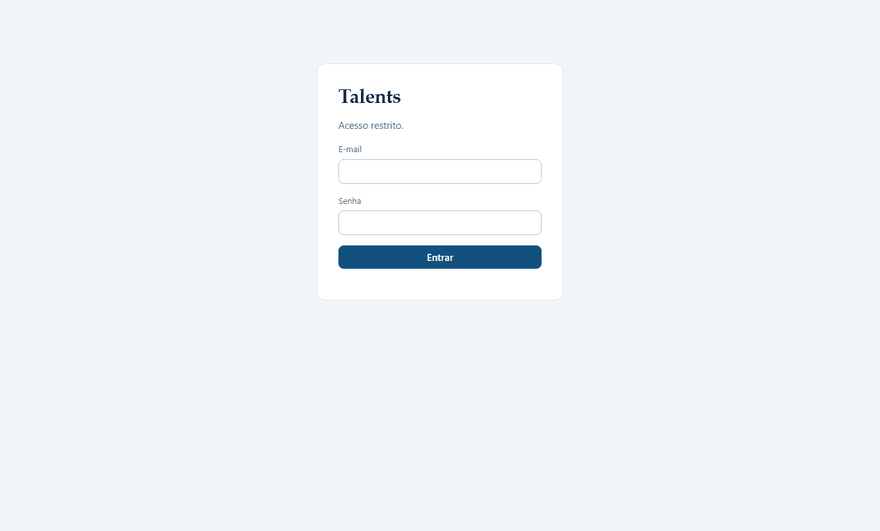
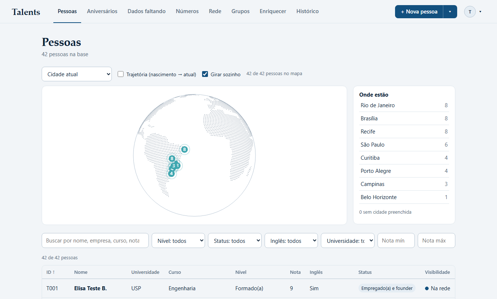
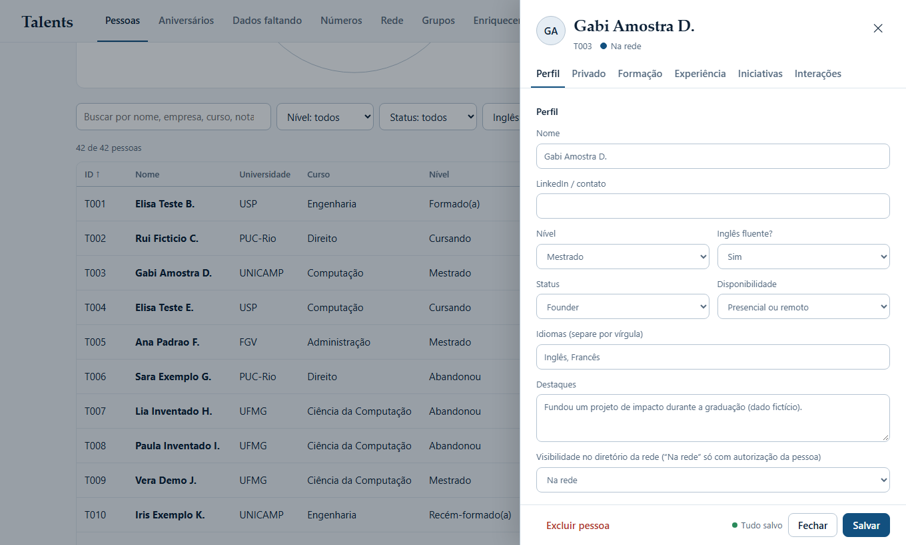
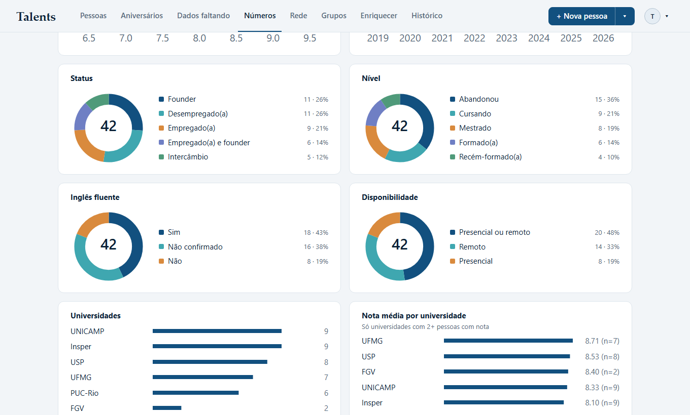
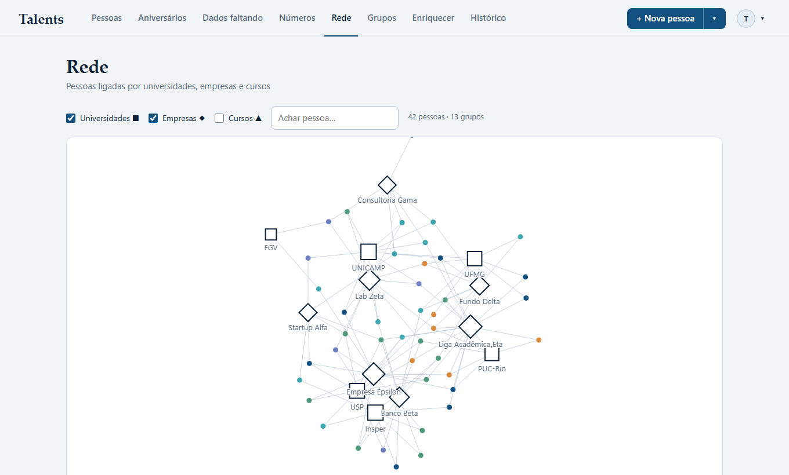
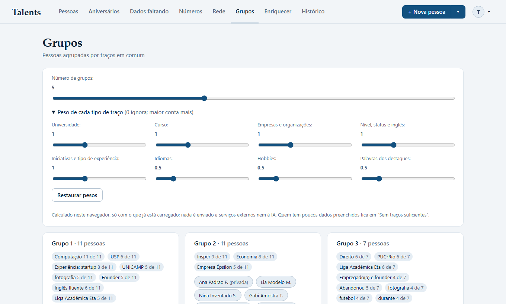
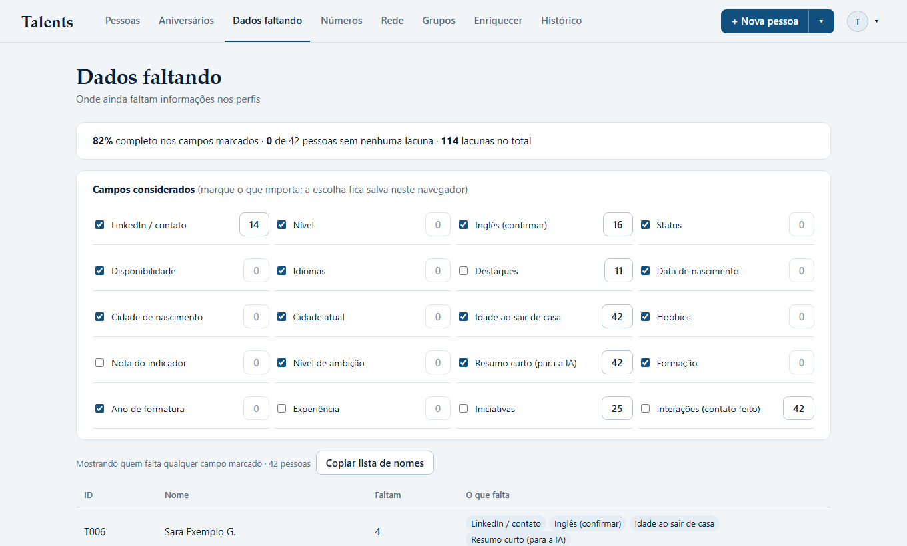

# Talents

Banco de dados de talentos universitários brasileiros, feito para quem quer **conhecer, acompanhar e conectar pessoas** de uma rede curada: um painel para o dono da base, um diretório de leitura para convidados e agentes de IA que ajudam a cadastrar, enriquecer e sugerir conexões, sempre com aprovação humana.

> Projeto pessoal, construído sozinho. **Todas as imagens abaixo usam dados fictícios** gerados para a demonstração. Nenhum dado real de pessoas está neste repositório.



## O problema

Uma lista de contatos em planilha não responde perguntas como: *o que essas pessoas têm em comum? quem eu deveria apresentar a quem? o que falta preencher? quem concordou em aparecer?* O Talents guarda cada pessoa com formação, experiência e iniciativas, e transforma isso em visões e sugestões, respeitando a privacidade de quem está na base (LGPD).

## O que faz

| | |
|---|---|
|  | **Pessoas.** Lista com busca, filtros e ordenação, mais um globo 3D em canvas puro com as cidades das pessoas. |
|  | **Perfil completo.** Dados públicos e privados separados (com o aviso "só você vê"), formação, experiência, iniciativas e interações. Salvamento único e confirmação ao fechar com alterações. |
|  | **Números.** Indicadores e gráficos desenhados em SVG, com clique que leva à lista já filtrada. |
|  | **Rede.** Grafo de força que liga pessoas por universidade, empresa e curso. |
|  | **Grupos.** Clusterização (k-means esférico) feita no navegador, com peso ajustável para cada tipo de traço. Nada sai do navegador. |
|  | **Dados faltando.** Lista o que ainda precisa ser preenchido, com os campos que você escolhe acompanhar. |

Além disso: aniversários com exportação `.ics`, histórico de todas as alterações com **desfazer**, padronização de nomes ("USP" e "Universidade de São Paulo" viram uma grafia só), backup em JSON e três funções de IA descritas abaixo.

## IA com limites claros

Três Edge Functions (Deno) chamam a API da Anthropic. Em todas valem as mesmas regras:

- **`cadastro-ia`**: o dono cola um texto livre e a IA devolve uma *proposta* de cadastro. Nada é gravado até ele conferir e clicar em "Confirmar e salvar".
- **`conectar-ia`**: sugere quem da base conectar com uma pessoa (cofundador, mentor, investidor...). A IA recebe só ids e traços não identificantes, nunca nomes, cidades ou datas de nascimento. Os nomes são anexados à resposta depois.
- **`enriquecer-ia`**: busca dados públicos faltantes com a ferramenta de busca na web e grava **propostas pendentes com a fonte**. O dono aprova, edita ou rejeita; correções de valores já preenchidos exigem confirmação explícita.

A IA nunca tem ferramentas de escrita, trata texto de terceiros como dado (não como instrução), tem limite de uso por hora e por dia e registra o consumo. Detalhes em [docs/PRIVACIDADE.md](docs/PRIVACIDADE.md).

## Como foi construído

- **Front-end sem build**: HTML, CSS e JavaScript puros (`app/` para o dono, `rede/` para convidados), dois sites separados. Gráficos, grafo, globo e clusterização sem nenhuma biblioteca, com uma **Content-Security-Policy estrita** (sem script ou estilo inline).
- **Supabase (Postgres)**: autenticação, Row Level Security em todas as tabelas e Edge Functions. O esquema está em [`schema.sql`](schema.sql) e as migrações em [`supabase/`](supabase).
- **Segurança no banco, não na página**: as políticas de RLS decidem quem lê o quê. Convidados não têm acesso a nenhuma tabela; só chamam uma função `SECURITY DEFINER` que devolve os campos permitidos para o nível de acesso de cada um. Há trilha de auditoria por triggers e rótulo de origem de cada dado.
- **Testes de interface**: 62 testes em Playwright rodam o painel real contra um **Supabase falso em memória**, bloqueiam qualquer host externo e falham em qualquer erro de console ou violação de CSP. Veja [`tests/README.md`](tests/README.md).
- **Design**: sistema visual próprio, descrito em [`DESIGN.md`](DESIGN.md).

## Decisões que valem a leitura

- **Privacidade por construção.** Dados pessoais (nascimento, cidades, hobbies, notas) vivem numa tabela separada que só o dono lê; o que a IA vê é uma lista fechada de campos.
- **Consentimento.** Cada pessoa começa como privada e só aparece no diretório da rede depois de autorizar.
- **Tudo desfazível.** Cada alteração vira uma linha de histórico com o antes e o depois, e o painel desfaz com um clique.
- **Poucos recursos, muito cuidado.** O plano gratuito não faz backup automático, então o painel lembra o dono de baixar uma cópia a cada sete dias.

## Rodando

Você precisa do seu próprio projeto Supabase; este repositório não inclui dados.

1. Crie um projeto no Supabase e rode [`schema.sql`](schema.sql) e as migrações de [`supabase/`](supabase) na ordem em que foram criadas.
2. Crie um usuário em *Authentication* e coloque o id dele na tabela `admin`. Deixe o cadastro público desligado.
3. Em `app/app.js` e `rede/app.js`, troque `SUPABASE_URL` e `SUPABASE_KEY` pela URL e pela chave **publicável** do seu projeto. Nunca use a chave `service_role` no front-end.
4. Publique as funções de `supabase/functions/` e defina o segredo `ANTHROPIC_API_KEY` no Supabase (nunca no código). Ajuste `ALLOWED_ORIGINS` para o seu endereço.
5. Sirva a pasta `app/` com qualquer servidor estático, por exemplo:

```bash
python -m http.server 5173 --directory app
```

### Testes e demonstração (sem Supabase)

```bash
cd tests
npm install
npx playwright install chromium
npm test                          # 62 testes contra o banco falso
node demo/capturar.mjs ../docs/img   # refaz as imagens e o GIF deste README
```

## Estrutura

```
app/        painel do dono (admin)
rede/       diretório de leitura para convidados
supabase/   migrações SQL e Edge Functions
schema.sql  esquema consolidado
tests/      testes Playwright e backend falso
docs/       regras de privacidade e imagens
```

## Aviso

Os dados mostrados nas imagens são inventados. O código é compartilhado para fins de portfólio; pelo `schema.sql` e pelas regras em `docs/PRIVACIDADE.md` fica claro como tratar dados de terceiros, mas se você montar uma base parecida, a responsabilidade pela conformidade com a LGPD é sua.
